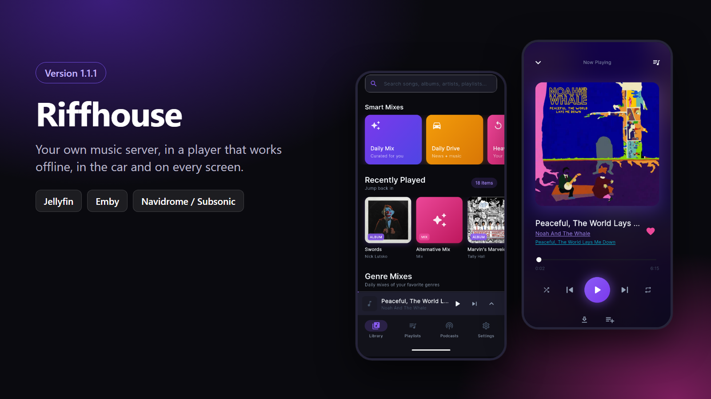
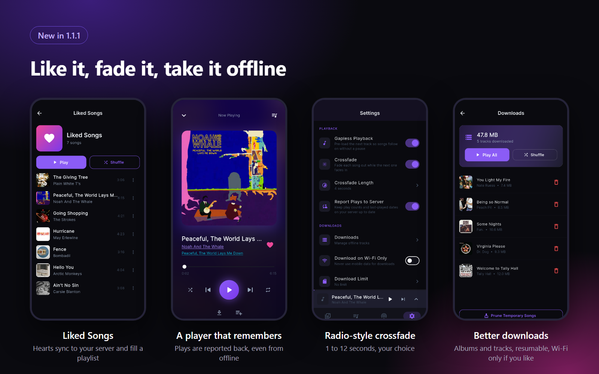
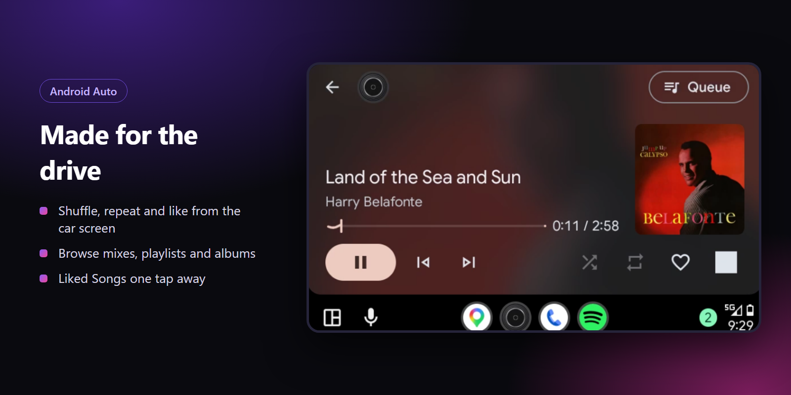
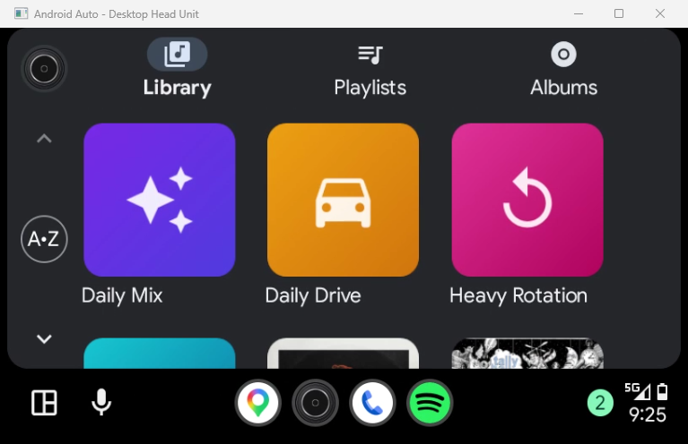

<div align="center">
  
  
  # Riffhouse
  
  **A native music streaming client for your self-hosted music server**
  
  [](https://github.com/Skeeter2600/Riffhouse/releases)
  [](LICENSE)
  [](https://flutter.dev)
  [](#platform-notes)
  [](https://buymeacoffee.com/skeeter26)

</div>

<p align="center">
  
</p>

---

## What is Riffhouse?

Riffhouse is a lightweight, cross-platform music streaming client that connects to your **self-hosted music server**: Jellyfin, Emby, or anything that speaks the Subsonic API (Navidrome, Gonic, Airsonic and others). No subscriptions, no tracking, no ads—just your music library, your way. Stream your personal collection anywhere, offline-first caching, integrated podcasts, and built-in Android Auto support.

**Perfect for:** Anyone running their own music server who wants a native, feature-rich music app that works offline and feels at home on their device.

---

## Screenshots

<p align="center">
  
</p>

<p align="center">
  
</p>

<p align="center">
  
</p>

---

## Table of Contents

- [Screenshots](#screenshots)
- [Quick Start](#quick-start)
- [Features](#features)
- [Installation](#installation)
  - [Pre-built Downloads](#pre-built-downloads)
  - [Updating](#updating)
  - [iOS Sideloading](#ios-sideloading)
- [Building from Source](#building-from-source)
- [Configuration](#configuration)
  - [Supported Servers](#supported-servers)
- [Tech Stack](#tech-stack)
- [Project Structure](#project-structure)
- [Troubleshooting](#troubleshooting)
- [Contributing](#contributing)
- [Support](#support)
- [License](#license)

---

## Quick Start

1. **Download** the latest [release](https://github.com/Skeeter2600/Riffhouse/releases) for your platform
2. **Install** using the instructions below
3. **Launch** Riffhouse
4. **Choose** your server type and enter its URL (e.g., `https://music.yourdomain.com`)
5. **Log in** with your account on that server
6. **Start streaming** your library instantly

Done! Your playlists, artists, and albums sync automatically.

---

## Features

### Core Streaming
- 🎵 **Jellyfin, Emby and Subsonic Servers** — Stream your entire music library with full artist, album, and playlist support (see [Supported Servers](#supported-servers))
- 📱 **Cross-Platform** — Native apps for Android, iOS, Windows, macOS, and Linux
- 🔄 **Persistent Playback** — Background audio service with lock-screen controls and persistent notifications

### Offline & Caching
- 💾 **Offline Playback** — Download playlists, albums or single tracks; downloads resume where they stopped, can be cancelled, and can be limited to Wi-Fi or a storage budget
- ⚡ **Offline Browsing** — Albums, artists and playlists you've opened stay browsable without a connection
- 🔁 **Server Sync** — Plays are reported back to your server (and queued while offline), so play counts match across your clients
- ❤️ **Liked Songs** — Like a track from the player, the notification or the car; likes are saved as favorites on your server and collected in a Liked Songs playlist
- 🎚️ **Crossfade** — Radio-style fades between songs, from 1 to 12 seconds
- 🗄️ **Backup & Restore** — Save your play history, stats, mixes and podcast subscriptions to a file

### Discovery & Organization
- 🎼 **Smart Mixes** — Daily Mixes, Heavy Rotation, and Undiscovered Tracks based on your listening habits
- 🎙️ **Integrated Podcasts** — Add RSS feeds alongside your music library in a unified player
- 📊 **Queue Management** — Full reorderable queue with persistent controls

### Mobile & Automotive
- 🚗 **Android Auto Integration** — Browse mixes, playlists, albums and Liked Songs, with shuffle, repeat and like buttons on the now-playing screen
- 🔒 **Lock Screen Controls** — Quick playback controls directly from your device lock screen

---

## Installation

### Pre-built Downloads

All releases are available on the [GitHub Releases](https://github.com/Skeeter2600/Riffhouse/releases) page.

| Platform | File | Installation |
|----------|------|--------------|
| **Android** | `Riffhouse-Android.apk` | Download and tap to install. Allow installation from your browser if prompted. |
| **Windows** | `Riffhouse-Windows-x64.zip` | Extract and run `Riffhouse.exe`. Windows Defender SmartScreen may appear—click "Run anyway." |
| **macOS** | `Riffhouse-macOS.zip` | Extract and drag `Riffhouse.app` to `/Applications`. If Gatekeeper blocks it, right-click → **Open**. |
| **Linux** | `Riffhouse-Linux-x64.tar.gz` | Extract into its own folder and run: `mkdir riffhouse && tar -xzf Riffhouse-Linux-x64.tar.gz -C riffhouse && ./riffhouse/riffhouse` |
| **iOS** | `Riffhouse.ipa` | See [iOS Sideloading](#ios-sideloading) below. |

#### Platform Notes

- **Android:** Works best on Android 8.0+. Android Auto requires Android 5.0+.
- **iOS:** Requires personal Apple ID for sideloading (free). Certificate refreshes every 7 days with AltStore.
- **Windows/macOS:** First launch may take 10–15 seconds on initial startup.

---

### Updating

Riffhouse checks GitHub for a new release when it starts. You can turn this off, or check by hand, under **Settings → Updates**.

| Platform | How updates arrive |
|----------|--------------------|
| **Android** | Downloaded in the app; Android asks you to confirm the install. The first time, you'll be asked to allow Riffhouse to install apps. |
| **Windows / Linux** | Downloaded in the app; **Install & restart** swaps the files and reopens Riffhouse. This needs the app to live in a folder you can write to (not `Program Files` or `/usr`). |
| **macOS / iOS** | The app tells you a release is available and links to it; install it the same way as the first time. |

---

### iOS Sideloading

Since Riffhouse isn't on the App Store, you'll use your Apple ID to sideload it. I am working on getting this (and adding Apple CarPlay support as well), but need further testing with it. For the time being, to just use it, there are two methods:

#### Method A: Sideloadly (Recommended for Beginners)
1. Download `Riffhouse.ipa` and install [Sideloadly](https://sideloadly.io/)
2. Connect your iPhone via USB (or Wi-Fi after initial pairing)
3. Drag `Riffhouse.ipa` into Sideloadly
4. Enter your Apple ID email and tap **Start**
5. On your iPhone: **Settings → General → VPN & Device Management**
6. Tap your Apple ID and trust the app
7. (iOS 16+) Enable **Developer Mode** in **Settings → Privacy & Security**

**✅ You're set!** The app stays installed until your certificate expires (7 days), then refresh via Sideloadly.

#### Method B: AltStore / SideStore (On-Device)
1. Install [AltStore](https://altstore.io/) or [SideStore](https://sidestore.io/)
2. Download `Riffhouse.ipa` in Safari on your iPhone
3. Open AltStore/SideStore → **My Apps** → **+**
4. Select the IPA to install
5. App auto-refreshes every 7 days if AltStore/SideStore stays open

---

## Building from Source

Want to contribute or customize Riffhouse? Here's how to build it yourself.

### Prerequisites

- [Flutter SDK](https://docs.flutter.dev/get-started/install) (3.x or higher)
- [Git](https://git-scm.com/)
- Platform-specific tools:
  - **Android:** Android Studio + Android SDK
  - **Windows:** Visual Studio 2022 (Desktop C++ development)
  - **macOS/iOS:** Xcode + CocoaPods
  - **Linux:** Clang, CMake, Ninja, GTK 3 dev libraries
    ```bash
    sudo apt-get install clang cmake ninja-build pkg-config libgtk-3-dev liblzma-dev
    ```

### Build Steps

```bash
# 1. Clone & enter the repo
git clone https://github.com/Skeeter2600/Riffhouse.git
cd Riffhouse

# 2. Install Dart & Flutter dependencies
flutter pub get
dart run build_runner build --delete-conflicting-outputs

# 3. Build for your platform (see below)
```

**Android:**
```bash
flutter build apk --release
# Output: build/app/outputs/flutter-apk/app-release.apk
```

> Android only installs an update over an existing app when both are signed with the same key. Official releases are signed with the project's release key, which is not in the repository; a build you make yourself is signed with your debug key, so it cannot be installed over an official release (or the other way round) without uninstalling first. To sign with your own key, create `android/key.properties` with `storeFile`, `storePassword`, `keyAlias` and `keyPassword`.

**Windows:**
```bash
flutter build windows --release
# Output: build/windows/x64/runner/Release/Riffhouse.exe
```

**macOS:**
```bash
flutter build macos --release
# Output: build/macos/Build/Products/Release/Riffhouse.app
```

**Linux:**
```bash
flutter build linux --release
# Output: build/linux/x64/release/bundle/riffhouse
```

**iOS (Sideloadable IPA):**
```bash
flutter build ipa --release --no-codesign
mkdir -p Payload
cp -r build/ios/archive/Runner.xcarchive/Products/Applications/*.app Payload/
zip -r Riffhouse.ipa Payload
```

---

## Configuration

### First Launch

1. Pick your **server type**: Jellyfin, Emby, or Navidrome / Subsonic
2. Enter the **server URL** (e.g., `https://music.example.com`) and log in with your username & password on that server
3. Your libraries sync automatically in the background

### Settings

- **Gapless Playback / Crossfade** — Choose how one song runs into the next
- **Report Plays to Server** — Keep your server's play counts and last-played dates up to date
- **Downloads** — See what is stored offline, prune the temporary cache or clear everything; optionally download on Wi-Fi only and set a storage limit
- **Backup** — Save or restore the listening data that exists only on this device
- **Automatic Updates** — Check for and download new releases on launch
- **Disconnect** — Sign out to connect to a different server or user

### Supported Servers

| Server type | Works with | Usual port | Notes |
|-------------|------------|------------|-------|
| **Jellyfin** | Jellyfin | 8096 | |
| **Emby** | Emby | 8096 | Shares Jellyfin's API. |
| **Navidrome / Subsonic** | Navidrome, Gonic, Airsonic, LMS, Ampache, Funkwhale, Nextcloud Music and other Subsonic or OpenSubsonic servers | 4533 (Navidrome) | Your password is not stored; a salted token is. The API has no call for setting a playlist cover, so a custom cover is saved on the device you set it on and is not shown on your other devices. |

Riffhouse connects to one server at a time. To switch, use **Settings → Disconnect** and sign in to the other one. Play history is recorded per track on the server it was played from, so it does not carry over between servers.

---

## Tech Stack

| Component | Technology |
|-----------|------------|
| **Framework** | [Flutter](https://flutter.dev/) (Dart) |
| **Media Backends** | [Jellyfin](https://jellyfin.org/) and [Emby](https://emby.media/) REST APIs, [Subsonic / OpenSubsonic](https://opensubsonic.netlify.app/) API |
| **State Management** | Riverpod / Provider pattern |
| **Local Database** | Drift / SQLite (offline metadata, caching) |
| **Audio Engine** | Flutter Audio Background Service with lock screen & automotive controls |

---

## Project Structure

```
lib/
├── audio/          # Background playback, queue, Android Auto integration
├── database/       # SQLite schema, DAOs, generated bindings
├── models/         # Library data models, podcasts, mix configs
├── providers/      # State management (Auth, Library, Podcasts, Database)
├── router/         # Navigation routing
├── screens/        # UI screens (Player, Library, Playlists, Settings)
├── services/       # Server clients (Jellyfin/Emby, Subsonic), podcasts, cache, playlists
├── theme/          # Theming, colors, typography
├── utils/          # Formatting and logging helpers
└── widgets/        # Reusable components (MiniPlayer, AlbumCard, etc.)
```

---

## Troubleshooting

**Android says "App not installed" when updating.**
The installed copy and the update are signed with different keys. Releases up to v1.1.0 were each signed with a throwaway key, so they cannot be updated in place: uninstall Riffhouse once, then install the latest APK from the [releases page](https://github.com/Skeeter2600/Riffhouse/releases). Your library lives on your Jellyfin server, but uninstalling erases what is stored only on the device: play history, listening stats, mix settings, podcast subscriptions and downloads. Those early releases have no backup option, so that data cannot be carried over from them. From v1.1.1 on, updates install in place, and **Settings → Backup** lets you save that data to a file before any reinstall.

**"Update available" keeps showing a release link instead of installing (Windows/Linux).**
The app can only replace its own files in a folder you can write to. Move the Riffhouse folder somewhere under your user profile or home directory.

**Moving to a new phone, or reinstalling.**
Use **Settings → Backup → Back Up Listening Data** on the old install, then **Restore from Backup** on the new one after signing in. The backup holds play history, stats, mix settings and podcast subscriptions. It does not hold your sign-in or downloaded audio; download those again.

**Can't sign in.**
Check that the server URL includes `http://` or `https://` and the port if your server uses one (for example `http://192.168.1.20:8096`), and that the address opens in a browser on the same device.

**Android Auto doesn't show Riffhouse.**
Sideloaded apps are hidden by default. In the Android Auto settings on your phone, tap the version number repeatedly to enable developer mode, then turn on **Unknown sources** in the developer settings.

**The iOS app stops opening after a week.**
Apps sideloaded with a free Apple ID expire after 7 days. Refresh it with Sideloadly, AltStore or SideStore.

---

## Contributing

We'd love your help! Whether it's bug reports, feature requests, or code contributions:

1. **Found a bug?** Open an [Issue](https://github.com/Skeeter2600/Riffhouse/issues)
2. **Have a feature idea?** Start a [Discussion](https://github.com/Skeeter2600/Riffhouse/discussions)
3. **Want to code?** Fork the repo and submit a [Pull Request](https://github.com/Skeeter2600/Riffhouse/pulls)

### Development Tips
- Use `flutter run` during development (hot reload enabled)
- Run tests with `flutter test`
- Code style follows Dart conventions (enforced by `dart format`)
- For Android Auto features, test on a real device or emulator with Google Play Services

---

## Support

Riffhouse is free and built in my spare time. If it's earned a spot on your home screen and you'd like to help keep it going, you can buy me a coffee:

<a href="https://buymeacoffee.com/skeeter26"></a>

---

## License

This project is licensed under the [MIT License](LICENSE) — free to use, modify, and distribute. Just please give me credit :)

---

**Have questions?** Open an Issue or start a Discussion on GitHub.
